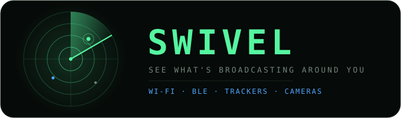
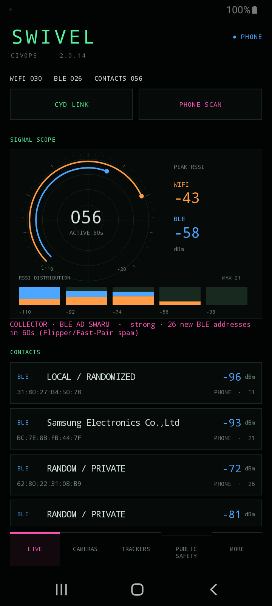

<p align="center">
  
</p>

<p align="center">
  <strong>See what's broadcasting around you.</strong><br>
  A passive, privacy-first Wi-Fi &amp; Bluetooth scanner for Android that flags nearby cameras, trackers, and surveillance gear — using only your phone.
</p>

<p align="center">
  
  
  
  
  
</p>

---

## What it is

SWIVEL turns an ordinary Android phone into a passive radio scanner. It listens to the Wi-Fi and Bluetooth advertisements already in the air around you, then classifies what it finds — surveillance cameras, item trackers (AirTag, Tile, SmartTag…), and public-safety gear (Flock, Axon/TASER, Motorola) — against a bundled, offline device database.

It is **receive-only**. It never transmits, never phones home, and never asks you to sign in. Everything stays on your phone.

<p align="center">
  
</p>

## Why it's private by design

- **Receive-only.** SWIVEL only *listens*. It sends no packets, runs no attacks, and can't interfere with any network.
- **No internet.** Device lookups use a bundled offline IEEE registry. The app makes no network calls.
- **No accounts, no analytics.** Nothing to sign up for, nothing phoned home.
- **Your data stays local.** Detections are kept on-device; you choose if and when to export them. A one-tap **duress wipe** clears the session and deletes any exports.

## What it detects

| View | What you get |
| --- | --- |
| **Live** | Wi-Fi and BLE observations, a signal-strength radar scope, and a distribution chart. Wi-Fi is amber; BLE is blue. |
| **Cameras** | IEEE manufacturer matches for camera makers — Ring, Wyze, Axis, Hikvision, Dahua, Reolink, Nest, Arlo, and more. Known router and Arlo base-station names are excluded. |
| **Trackers** | Apple Find My signatures, Tile and Samsung SmartTag service UUIDs, Chipolo/Pebblebee, and explicitly advertised tracker names. |
| **Public Safety** | Flock Safety, Axon/TASER, Motorola Solutions, WatchGuard Video, and Digital Ally — by IEEE vendor and Bluetooth SIG identifiers. |
| **Threat** | Evil-twin and karma/pineapple heuristics, BLE advertisement swarms, and (with a CYD) Wi-Fi deauth/attack detection. |
| **Signal details** | Full signal history, address, manufacturer, match evidence, source, observation ages, and the raw radio fields received. |

> **A signature is evidence, not proof.** An IEEE assignment identifies an *organization*, not a confirmed product or its state. Some camera makers also sell routers and hubs; a Find My signature doesn't prove an AirTag; a Flock or Axon match doesn't establish a model, recording state, or the presence of police. Silent devices can be missed. The radar shows signal strength — it does not locate or measure distance.

## Install

**Build it yourself** (works today, see below), or grab a signed build from the [Releases page](https://github.com/officialtomblack/MILLIEBLK/releases) once published. An F-Droid listing is planned.

1. Install the APK (enable "install unknown apps" for your browser/file manager if prompted).
2. Open **SWIVEL** and grant **Location** and **Nearby devices / Bluetooth**. Keep Wi-Fi, Bluetooth, and location services on.
3. Tap **PHONE SCAN**. Tap any signal for its full details.

> Requires **Android 8.0+**. Wi-Fi scan cadence and caching are controlled by Android. No Termux, no root.

## Build from source

Needs **JDK 17** and the Android SDK (`ANDROID_SDK_ROOT` set, or `local.properties` → `sdk.dir`).

```bash
cd millie2/android
./gradlew assembleDebug
# → app/build/outputs/apk/debug/app-debug.apk
```

Full build notes: [millie2/android/README.md](millie2/android/README.md).

## Optional: add a CYD (ESP32)

The phone works entirely on its own. For more reach, a [CYD](docs/millie2-cyd.md) (an ESP32 board) plugs in over USB and adds what a phone's radios physically can't see: **2.4 GHz Wi-Fi management/control frames** and **deauth / attack detection**, plus a second scanning radio.

1. Flash the firmware (see the [hardware guide](docs/millie2-cyd.md) — it's an app-partition image, not a full-flash).
2. Connect the CYD to a USB-OTG port with a **data cable**.
3. Open SWIVEL, tap **CYD LINK**, accept the USB prompt. **PHONE + CYD** means both are active; shared devices merge into one record.

The Android app owns all classification; the firmware only streams raw observations. No touch input needed on the CYD.

## Verification

Verified on a **Samsung Galaxy A12 (Android 12)**: live Wi-Fi + BLE scanning, device classification, the runtime permission flow (including the background-location step), and CSV/KML export all confirmed on-device. The Android 14/15 location-foreground-service path and screen-off scanning are not yet device-verified.

More: [parallel scans & dedup](docs/millie2-verification.md) · [public-safety matching & sources](docs/millie2-public-safety.md) · [IEEE registry provenance](millie2/android/app/src/main/assets/IEEE_REGISTRY_SOURCE.txt).

## Credits & license

Maintained by [**@officialtomblack**](https://github.com/officialtomblack) — a privacy-focused, security-hardened fork.
Originally created as **MILLIE** by *idea grey* ([upstream](https://github.com/IDEAGREY/MILLIE)); see [docs/project-history.md](docs/project-history.md) for lineage.

Licensed under the **MIT License** — © 2026 tcmidiservices. See [LICENSE](LICENSE).
