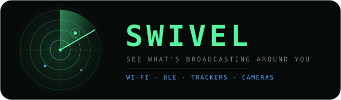
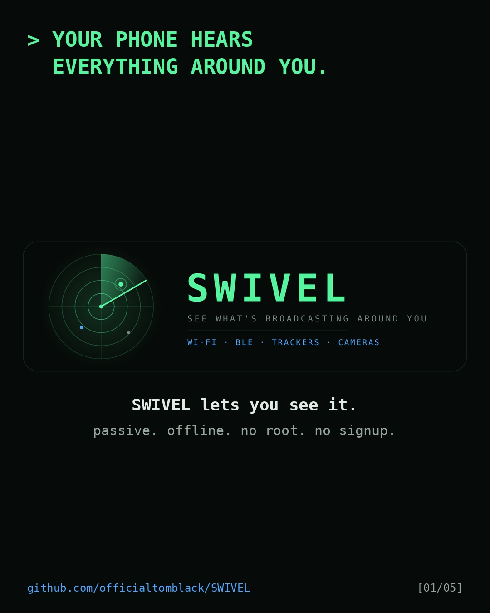
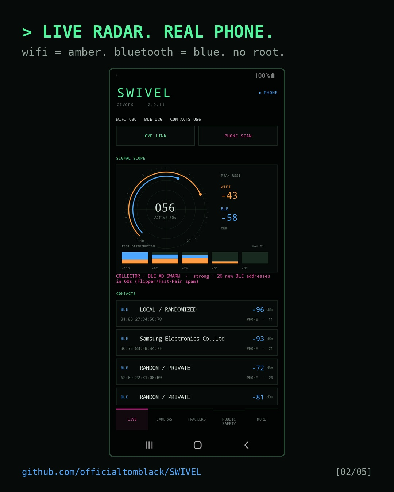
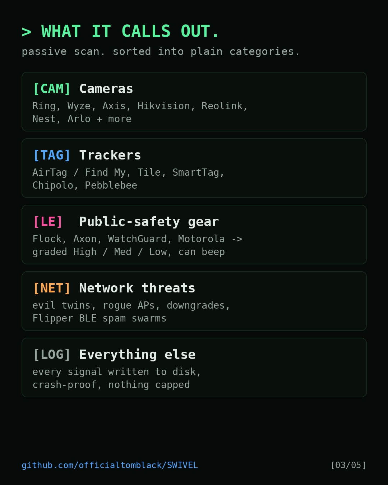
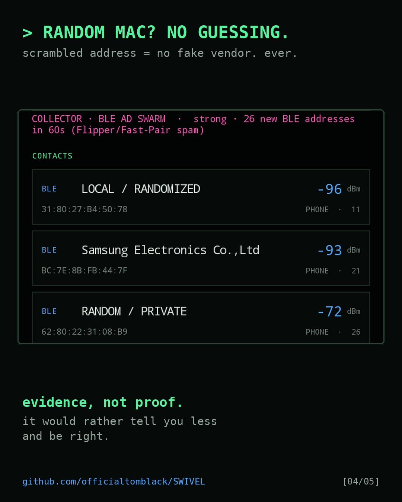

# SWIVEL

<p align="center">
  
</p>

<p align="center">
  <strong>Your phone can already hear every camera, tracker, and gadget broadcasting around you.</strong><br>
  SWIVEL just lets you <em>see</em> them — and keep the receipts. No hacking. No signups. Nothing ever leaves your phone.
</p>

<p align="center">
  
  
  
  
  
  
  
</p>

<p align="center">
  📖 <strong>New — a full guide:</strong> the <a href="https://github.com/officialtomblack/SWIVEL/wiki">SWIVEL Wiki</a> has an FAQ, a plain-English glossary, and a walkthrough of every screen.
</p>

---

## 👁️ What SWIVEL does for you

<p align="center">
  
</p>

Every Wi-Fi network, every AirTag, every security camera, every Bluetooth gadget nearby is **announcing its presence into the air all the time.** Your phone's radios pick up those announcements — it just never shows them to you.

SWIVEL turns that on. Open the app and it immediately starts **scanning** the Wi-Fi and Bluetooth signals around you, sorts them into plain categories — **cameras, trackers, surveillance gear, suspicious networks** — and quietly writes down *everything* it hears so you can look back later.

- 🛰️ **Passive — it never attacks.** SWIVEL doesn't deauth, inject, jam, join, or connect to anything. It uses the same ordinary Wi-Fi and Bluetooth scanning your phone already does every day — it just shows you the results and records them. (It sends the normal "discovery" pings any phone sends to find networks and devices, and nothing more.)
- 🔌 **No cloud. Ever.** The app never contacts a remote server, and nothing you see is ever sent anywhere — it figures out who made a device from a dictionary built right into the app. (It requests the INTERNET permission only so the optional **SWEEP SUBNET** tool can probe devices on *your own Wi-Fi*; that traffic never leaves your local network.)
- 🙅 **No account, no signup, no analytics.** Install it, open it, done. There is nothing to log into and nothing phoning home.
- 📱 **Just a normal phone.** Android 8.0 or newer. No "rooting," no Termux, no technical setup.

> You don't need to be a hacker, a programmer, or a security expert — you don't even need to know what a "MAC address" is. If you can install an app and tap a button, you can use SWIVEL.

---

## 🚀 Quick start (literally 4 steps)

<p align="center">
  
</p>

1. **Install it.** Put the app on your phone (see [Get the app](#-get-the-app) below). If Android warns about "installing unknown apps," allow it for your browser or file manager — that's normal for apps outside the Play Store.
2. **Open SWIVEL and say yes to two things.** It asks for **Location** and **Nearby devices / Bluetooth**. It needs these to *hear* radios — not to find *you*. (Your location only ever gets written into your own private log, and that log never leaves the phone.)
   - ⚠️ Keep Wi-Fi, Bluetooth, **and** your phone's Location switch turned **on**. Android hands back *nothing* while the system Location toggle is off — even after you've granted permission. That's an Android rule, not a SWIVEL one.
3. **That's it — scanning starts by itself.** No "start" button to hunt for. The **LIVE** screen fills up with blips: 🟡 amber is Wi-Fi, 🔵 blue is Bluetooth. The radar scope shows which signals are strong (close) and which are faint (far).
4. **Tap around.** Flip between the tabs across the bottom:

| Tab | What it's showing you |
|---|---|
| **LIVE** | Everything, as it comes in, on the radar scope. |
| **CAMERAS** | Devices made by known camera brands. |
| **TRACKERS** | AirTags, Tiles, SmartTags and friends — including a **"this one is following you"** alert. |
| **PUBLIC SAFETY** | Gear from surveillance and law-enforcement vendors. |
| **ALERTS** | A running list of everything that set off an **audible alert** — tap any entry for the full detail. |
| **MORE** | Your controls: the capture toggle, the quiet button, the alert on/off, EXPORT, and the panic wipe. |

**Something got flagged — now what?** Tap it. SWIVEL shows you *exactly why* — the signal history, the raw radio details, and the evidence behind the label. Nothing is hidden, and nothing is dressed up as more certain than it is (see [Evidence, not proof](#-evidence-not-proof)).

### 🔔 Hear it before you see it — alerts for police gear & cameras

SWIVEL can **beep out loud** the moment it hears equipment linked to law-enforcement / surveillance vendors near you, so you don't have to be staring at the screen:

- **Three beeps** = a high-confidence hit: body-camera, in-car-video and ALPR makers (Axon, Flock, WatchGuard Video, Digital Ally, L-3, Utility, ELSAG, Neology, Skydio, Cellebrite).
- **One beep** = a lower-confidence hit: gear agencies use that's *also* sold widely (Motorola radios, in-car routers like Sierra / Cradlepoint, business CCTV like Verkada / Axis). Expect more false alarms here — a delivery van's router can set it off.
- Every hit lands on the **ALERTS** tab (newest first); tap it for the signal, the vendor and the evidence.
- It won't nag: the same device only re-alerts after about **90 seconds**, so one car beside you doesn't beep non-stop — but a *different* vehicle still alerts on its own.
- Turn it on or off under **MORE → LE / CAMERA ALERTS**. The beep uses your **alarm** volume, so you hear it even on silent.
- **Tune it** under **MORE → ALERT SENSITIVITY**: *Low* (only the high-confidence tier, longest gap between repeats), *Medium* (the default), or *High* (includes the lower-confidence gear and repeats sooner). **Flag** any device from its detail screen (☆ → ★) and the star shows wherever it appears.
- **Smart promotion:** a dual-use device (a router or radio) that turns up right alongside high-confidence gear — say a Cradlepoint router next to an Axon — gets bumped up to the loud three-beep. The *pair* reads as an equipped vehicle, where either one alone is weaker. It's based on timing, so treat it as a strong hint, not proof.
- **Fixed cameras (optional location track):** the Flock / ALPR poles on the street don't broadcast anything, so SWIVEL can't *hear* them — instead it can warn when your GPS comes within ~150 m of a camera **you've mapped**. Drop a plain `alpr_points.csv` (one `lat,lon` per line — e.g. exported for your area from a public ALPR map) into the app's `assets/` folder before you build. **No camera coordinates ship in this project** — the map is yours and stays on your device. Toggle it under **MORE → CAMERA LOCATION ALERTS**; heads-up, it tightens the GPS poll while on, so it uses more battery.

**Read the label, not your fears.** A match means *a device made by that vendor is nearby* — it is **not** proof that police, any agency, or any person is present (the same routers ride in utility trucks and ambulances). SWIVEL says "probable," never "a cop."

**Why you might not hear a *camera*:** most **fixed** cameras — Flock / ALPR poles, traffic and pole cams — run on solar + cellular and put out **no Wi-Fi or Bluetooth at all**, so a passive scanner simply can't hear them. SWIVEL alerts on gear that *does* transmit — body cams, in-car systems, and the patrol car's own Wi-Fi. (Flagging fixed cameras by map location is planned for a later build.)

---

## 🔒 Where your stuff lives — and how to wipe it (plain English)

This is the part that matters, so here it is with no jargon.

### 📍 It all stays on your phone
Everything SWIVEL hears is written into **the app's own private folder** — a locked box that *no other app on your phone can open.* It is not in the cloud. It is not on a server. There is no "SWIVEL account" holding your data, because there is no account at all. **Nothing is ever uploaded.**

### 📤 Want a copy on your computer? Tap EXPORT
One tap on **EXPORT** makes a shareable copy of your session in four formats at once — a spreadsheet (CSV), a map file (KML, opens in Google Earth), a data file (JSON), and a `WigleCSV` that war-driving tools like Kismet and WiGLE understand. The copy lands in a folder you can reach from a computer:

```
Android/data/com.millie.civops2/files/
```

To get it onto a computer: plug the phone in with a USB cable and open that folder like a USB stick, or use your phone's **Files** app to copy it out. From there *you* decide where it goes — SWIVEL hands it to Android's normal share sheet and steps back. It never sends it for you.

### 🧨 Want it all gone? Tap DURESS · CLEAR ALL
One tap on the **DURESS · CLEAR ALL** panic button instantly:
- 🗑️ deletes **every** saved session log off the phone,
- 🗑️ deletes **every** export you've made, and
- 🧹 clears everything out of memory, then starts fresh.

No "are you sure," no recovery, no leftovers. *(Checked on a real phone during one session: one tap wiped 5 session logs and 4 exported files off the disk, instantly.)*

### 🤫 Why so careful about the cloud?
Because your log can include **your GPS location** on many of its lines — a record of where *you* were when you heard each signal. That is exactly why SWIVEL keeps it locked on your phone, and why this project deliberately keeps those files out of its public code (they're git-ignored). Your map is yours. Full stop.

---

## ✨ What it can spot

<p align="center">
  
</p>

| 🎯 | Category | What SWIVEL flags |
|---|---|---|
| 📷 | **Cameras** | Devices made by known camera brands — Ring, Wyze, Axis, Hikvision, Dahua, Reolink, Nest, Arlo and more — matched against a built-in manufacturer registry. Common router/base-station names (Spectrum, TP-Link, Netgear, ASUS, Linksys, Eero, Arlo bases) are filtered out so they don't cry wolf. |
| 🏷️ | **Trackers following you** | Apple **Find My** / AirTag signatures, **Tile**, Samsung **SmartTag**, Chipolo, Pebblebee, and named trackers — plus a **"separated tracker is traveling with you"** alert for the classic AirTag-in-your-bag case. *(Implemented and wired up; not yet verified against a real separated tag on a device.)* |
| 🚔 | **Public-safety gear** | Hardware from **Flock Safety, Axon/TASER, Motorola Solutions, WatchGuard Video, Digital Ally** — matched by manufacturer and Bluetooth identifiers and graded **High / Medium / Low** by how specific the match is. Look-alike companies (Flock Audio, Motorola Mobility, WatchGuard Technologies) are deliberately kept out so they can't trip a false alarm. |
| ⚠️ | **Network threats** | **Evil-twin** fakes, **karma/pineapple** rogue access points, **security-downgrade** tricks, and **Bluetooth advertisement swarms** (Flipper / spam). |
| 📝 | **Full-capture logging** | Not just the scary stuff — it writes down *everything* it hears, every network and every gadget, so you have a complete record to review later. |
| 📤 | **One-tap export** | CSV + KML + JSON + WigleCSV, all at once, streamed straight from the saved file so even huge captures never choke the phone. |
| 🧨 | **One-tap panic wipe** | DURESS · CLEAR ALL erases every log and every export off the disk in a single tap. |

### 🗃️ It keeps *everything* — and it's crash-proof

SWIVEL doesn't just show you blips and forget them. **Every** Wi-Fi access point and **every** Bluetooth advertisement — including ones with scrambled, randomized addresses, and every network name — gets written to a session file **the instant it arrives**, one line at a time.

- 🧱 **Nothing is collapsed, throttled, or capped.** It doesn't squish duplicates together or stop after some limit — it keeps the lot.
- 🛟 **It survives a crash.** A background writer flushes each batch of signals to disk as it goes, so if Android kills the app in the background, you lose at most the last split-second still in flight — never the session.
- 🔬 **Every line is rich.** Time, signal type, address, the real maker *(only when the address is genuinely traceable — see the rule below)*, the classification and *why* it was flagged, network name, signal strength, channel, security type, the raw Bluetooth and Wi-Fi fields, and your GPS position **when a fix is available.**
- 🎚️ **Your call on how much.** **LOG EVERYTHING** (the default) captures it all; flip to **FLAGGED ONLY** to keep just the devices that tripped an alert.
- 🤐 **A real "go quiet" button.** **PHONE SCAN · ON/OFF** genuinely stops every radio and the background service — not a fake label. *(Checked on a real phone: with it OFF the live counters freeze cold; flip it ON and they climb again.)*

---

## 🎖️ Evidence, not proof

<p align="center">
  
</p>

Most "detector" apps overpromise. SWIVEL does the opposite — on purpose — and it's the thing that makes it worth trusting.

**The hard rule:** a device with a **randomized or scrambled address gets labeled as random, and *never* gets assigned a maker.** SWIVEL flat-out refuses to guess who built something from an address that doesn't carry that information. This rule is enforced the moment anything is written to the log, it's obeyed by every detector, and it's double-checked afterward by the desktop tool. *(Re-audited on one real session's capture of 1,478 rows: **zero** breaks of the rule.)*

And when SWIVEL *does* name a maker, here's what that means and what it doesn't:

> **A signature is evidence, not proof.** Matching a manufacturer tells you *"this is hardware made by company X."* It does **not** prove which product it is, that it's recording, or that any agency or person is present. Some camera brands also make routers. A Find My signature isn't proof of an AirTag. Silent devices get missed. The radar shows signal strength — it does not pinpoint a location.

That honesty *is* the feature. SWIVEL would rather tell you less and be right than hype you up and be wrong.

---

## 👣 See what's been following you — add DEBRIEF

SWIVEL hears it. **[DEBRIEF](https://github.com/officialtomblack/DEBRIEF)** tells you what it *meant.*

On its own, SWIVEL gives you a live radar and a complete log. **DEBRIEF turns that log into an answer.** Feed it your SWIVEL exports — and your Kismet captures too, if you run a laptop rig — and it:

- builds **one database across every outing**, so it can flag the trackers and gadgets that **kept turning up at more than one of your places** (your neighbour's router stays put; a tag slipped in your bag doesn't);
- calls out **evil-twin hotspots**, **Kismet IDS alerts**, and the devices **both radios confirmed**;
- writes a ranked, click-to-expand report that shows *why* each thing was flagged — offline, no accounts.

Try it on its built-in demo in **60 seconds**, and once you're capturing your own, a one-line starter script turns each outing into a single command. **If you use SWIVEL more than once, DEBRIEF is what makes the captures add up.**

**→ [github.com/officialtomblack/DEBRIEF](https://github.com/officialtomblack/DEBRIEF)**

---

## 🖥️ Quick on-device checker (optional)

Want a fast look at a single exported capture without the full pipeline? The bundled **[`tools/swivel_crosscheck.py`](tools/README.md)** fills in device makers, re-audits the randomized-address hard rule, and — opt-in only — looks up Wi-Fi networks on WiGLE or nearby ALPR/Flock cameras via OpenStreetMap, never uploading your capture file or GPS track. Full commands: **[tools/README.md](tools/README.md)**.

For everything beyond a quick check — **every outing merged into one history, "followed" flags, the ranked report** — use **[DEBRIEF](https://github.com/officialtomblack/DEBRIEF)** above. It's the grown-up successor to this helper, and where the project's work goes now.

---

## 📥 Get the app

### ✅ Easiest way — download & install (about 2 minutes, no computer needed)

Do all of this **on the phone you want to use it on:**

1. **Open the download page:** **[github.com/officialtomblack/SWIVEL/releases/latest](https://github.com/officialtomblack/SWIVEL/releases/latest)**
2. Scroll to **Assets** and tap the file that ends in **`.apk`** (e.g. `SWIVEL-2.0.16.apk`, about 1.4 MB). It downloads in a second or two.
3. **Tap the downloaded file** — pull down the notification shade and tap it, or open your **Files** app and find it under *Downloads*.
4. Android will say it won't install apps "from this source." **This is normal for any app that isn't from the Play Store — it is not a warning about SWIVEL.** On that prompt tap **Settings**, switch on **Allow from this source** for your browser (Chrome, Firefox…) or your Files app, press **back**, then tap **Install**.
5. **Open SWIVEL.** Done — now follow [Quick start](#-quick-start-literally-4-steps) at the top.

> **📲 Updating later** — just download the newer `.apk` the same way and install it on top of the old one. Your settings and your saved logs stay put, and you don't need to uninstall first. *(Every release is signed with the same developer key — `CN=SWIVEL` — which is what lets Android update it in place instead of making you wipe and reinstall.)*
>
> **🔐 Is sideloading like this safe?** The whole source code is in this repo, the app never contacts a remote server (see the badges at the top), and every build is signed with one fixed key you can check yourself with `apksigner verify --print-certs`. "Unknown apps" is simply Android's label for *anything installed outside the Play Store* — it doesn't mean anything is wrong with the file.

### 🔄 Best for auto-updates — install with Obtainium

[**Obtainium**](https://github.com/ImranR98/Obtainium) is a free, open-source installer that watches a project's GitHub releases and **auto-updates the app for you** — so SWIVEL stays current without you ever checking back. It's the closest thing to an app-store experience, with no account and no middleman.

1. Install **Obtainium** itself — it's on [F-Droid](https://f-droid.org/packages/dev.imranr.obtainium.fdroid/) or [GitHub](https://github.com/ImranR98/Obtainium/releases).
2. **On your phone**, tap the badge below. It opens Obtainium with SWIVEL already filled in — just confirm, and it starts tracking this repo.

<p align="center">
  <a href="https://apps.obtainium.imranr.dev/redirect?r=obtainium://app/%7B%22id%22%3A%22com.millie.civops2%22%2C%22url%22%3A%22https%3A%2F%2Fgithub.com%2Fofficialtomblack%2FSWIVEL%22%2C%22author%22%3A%22officialtomblack%22%2C%22name%22%3A%22SWIVEL%22%7D"></a>
</p>

> No badge, or you're on a computer? In Obtainium tap **Add App** and paste `https://github.com/officialtomblack/SWIVEL` — exactly the same result.

From then on Obtainium pings you whenever a new SWIVEL release lands and installs it over the top, keeping your logs (same signing key). This is the easiest way to **never miss an update**.

*A classic **F-Droid** catalog listing has been requested too; until then, Obtainium above already gives you the install-and-auto-update experience today, straight from this repo.*

### 🛠️ For developers — build it from source

Prefer to compile it yourself? You'll need **JDK 17** and the Android SDK (`ANDROID_SDK_ROOT` set, or `local.properties` → `sdk.dir`).

```bash
cd millie2/android
./gradlew assembleDebug
# → app/build/outputs/apk/debug/app-debug.apk
```

Full build notes: [millie2/android/README.md](millie2/android/README.md) · full feature map: [docs/FEATURES.md](docs/FEATURES.md).

---

## ✅ Verification status (the honest version)

Tested on a **Samsung Galaxy A12 (Android 12)** — these are results from field sessions on that one device, not guarantees for every phone:

- ✔️ The on-device instrumentation suite **passes** — dual-source merge, device classification, the randomized-MAC hard rule, evil-twin logic, Bluetooth↔Wi-Fi correlation, and the persistent-log round-trip.
- ✔️ **EXPORT** was driven on the real UI and produced a valid **WigleCSV** — most recently 1,091 rows, 0 hard-rule breaks on independent re-audit. `FirstSeen` is written in **UTC** (so it lines up with Kismet), and a **device-type** column (Classic / LE / dual) is now included.
- ✔️ The **PHONE SCAN** toggle truly stops and resumes the radios (live counters freeze, then climb again).
- ✔️ **DURESS · CLEAR ALL** wiped every session log *and* every export off the disk, confirmed on the device.
- ⏳ **Not yet device-verified:** the Android 14/15 location-foreground-service path, screen-off (screen-locked) scanning, the Android-15 public-address recovery (see below), and the separated-tracker "following you" alert against a real tag. If you're on Android 14 or 15, treat those as unconfirmed for now.

### 🔧 Recent fixes — 2026-10-31

An independent audit of six suspected issues found **three real** (now fixed) and **three non-issues** (listed here for honesty):

- **Microsoft "Swift Pair" label** now checks the CDP scenario byte (`0x03`) instead of labelling *every* Microsoft advertisement — an ordinary Nearby-Share / Phone Link beacon (`0x01`) is no longer mislabelled.
- **WigleCSV `FirstSeen`** is now written in **UTC** (it was device-local with no zone marker), so SWIVEL exports line up with Kismet's own WigleCSV when the two are merged.
- **Bluetooth device type** (Classic / LE / dual) is now carried into the exports, not just shown in the app detail view.
- **Address type (Android 15+):** when the OS can confirm a BLE address is public, SWIVEL uses that to recover a maker — while *still* never naming a randomized address (the hard rule is unchanged).
- **Location:** the scanner now listens to GPS **and** network providers and keeps the more precise fix, instead of settling for coarse network accuracy.
- **EXPORT button:** disables itself and shows "Exporting…" while a run is in progress, so a double-tap can't launch two exports writing the same file — which corrupted a large capture's `.json`/`.csv` in testing.

Not actually bugs (confirmed against the source): the randomized-address "guess" already errs safe (a random address never gets a maker), the logged GPS accuracy was already the real OS value, and the WigleCSV already carried every column.

### 🆕 New in 2026-11-02 — IP collection & richer device class

SWIVEL's passive radio scan sees MAC addresses and network names; **IP addresses live one layer up**, inside the traffic a scanner isn't part of — so this release adds three ways to capture them, plus more device detail:

- **SWEEP SUBNET (MORE → tools):** a *manual*, one-tap active sweep of the Wi-Fi network your phone is **currently joined to**. It lists the live hosts on that subnet (a fast TCP connect-scan) and, where Android allows it, maps each to its **MAC** by reading the kernel's own neighbour table — no root. Each host is logged as a `SWEEP` record (`ip`, and `mac` when available). It only runs when you tap it, and only against the network you're on — use it on networks you own or are authorized to test.
  - *MAC availability:* works out of the box on **Android 8–12**. On Android 13–15 the OS blocks the neighbour-table read for a modern-target app, so you'll get the IP list but MAC shows blank unless the app is built at a lower target — the IP sweep itself always works.
- **Own-network record (`SELF`):** each session now logs the network **your phone** is on — SSID, the AP's BSSID, your phone's own IP, gateway and subnet — so a capture records *where it was taken from*. Your phone's IP is kept on its own record and is never written onto the access point's row.
- **More device class, offline:** SWIVEL now logs each Bluetooth device's **GAP Appearance** (BLE) and **Class-of-Device** (Classic) when the advert carries it, so [DEBRIEF](https://github.com/officialtomblack/DEBRIEF) can name what a device *is* (phone, watch, audio, computer…) without any lookup.

These feed **[DEBRIEF](https://github.com/officialtomblack/DEBRIEF)**, the desktop companion, which folds `ip`/`mac` into a device's `observed_ip` column and decodes the class fields. Everything still stays on your phone until you EXPORT; the sweep talks only to the local network, never the cloud.

More detail: [feature map](docs/FEATURES.md) · [parallel scans & dedup](docs/millie2-verification.md) · [public-safety matching & sources](docs/millie2-public-safety.md) · [IEEE registry provenance](millie2/android/app/src/main/assets/IEEE_REGISTRY_SOURCE.txt).

---

## 📜 Credits & license

Maintained by [**@officialtomblack**](https://github.com/officialtomblack) — a privacy-focused, security-hardened fork.
Questions, bug reports or security issues: [theredwake.sh@protonmail.com](mailto:theredwake.sh@protonmail.com)
Originally created as **MILLIE** by *idea grey* ([upstream](https://github.com/IDEAGREY/MILLIE)); see [docs/project-history.md](docs/project-history.md) for the lineage.

Licensed under the **MIT License** — © 2026 tcmidiservices. See [LICENSE](LICENSE).

<p align="center"><sub>SWIVEL watches the airwaves. It never attacks. Your data never leaves your hands.</sub></p>
